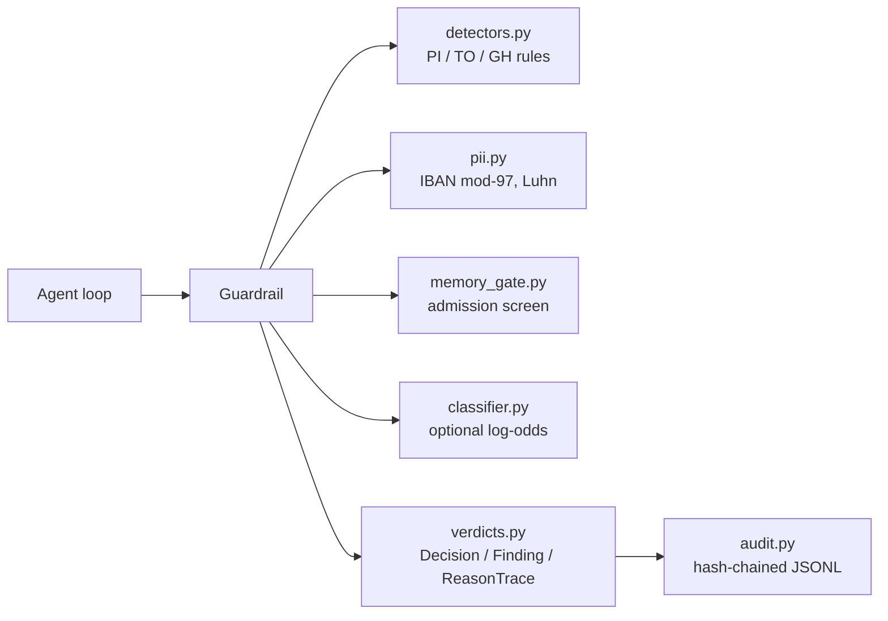

# Architecture

## 1. Design goals

1. **Explainable by construction.** A verdict without its evidence is a
   black box. Every finding carries a rule id, a span, and a confidence,
   and the verdict renders as plain English.
2. **Deterministic and offline.** Stdlib only, CPU-only, no model calls.
   The same input always produces the same verdict. Median screening
   time 0.25 ms.
3. **Fail closed.** A detector error raises; it never silently passes
   traffic. A REVIEW escalates instead of guessing.
4. **Provenance-aware.** Where text came from changes how it is judged:
   tool output is untrusted data, a user note is trusted more than a
   web-summarised one, and a memory write from an untrusted source is
   screened harder.

## 2. Module map

- `verdicts.py` — the data types. No detection logic lives here.
- `detectors.py` — pure functions from text to findings. Rules are
  data (`Rule` dataclasses) so they can be listed, counted, and
  ablated without running the guardrail.
- `pii.py` — detection plus `redact()`, used by the audit log so the
  log itself cannot leak.
- `memory_gate.py` — a separate decision type (`ADMIT / QUARANTINE /
  REJECT`) because a memory write is not a message: quarantine (hold
  for a human) is a meaningful middle state that "allow/block" cannot
  express.
- `classifier.py` — the only learned component. Kept separate and
  opt-in so the deterministic path never depends on it.
- `guardrail.py` — the orchestrator: picks which detectors run at each
  checkpoint and applies the policy thresholds.
- `audit.py` — append-only hash chain over verdicts.
- `benchmark.py` — fixture evaluation; no production dependency.

## 3. Why regex, not a model

Three reasons, all stated in the README as limits:

1. **Auditability.** A rule that fired can be quoted in an incident
   report. A model score cannot.
2. **Cost and latency.** A screen must run on every tool output; an
   extra model call per message doubles cost and latency.
3. **Determinism.** The same input must give the same verdict, or the
   audit log is meaningless.

The price is coverage: paraphrase and novel attack families evade
regex. That is why the classifier exists as an opt-in second opinion,
capped so it can only escalate — and why the benchmark section reports
what still gets through instead of hiding it.

## 4. Policy

`Policy` (v1.0.0): block ≥ 0.75, review ≥ 0.45. Thresholds are policy
choices, not calibrated probabilities. The experiment log records how
they behave on the fixtures; tune them on your own traffic with the
audit log before enforcing BLOCK in production.

## 5. SQLite vs files

There is no database. Verdicts are either returned in memory or
appended to a JSONL audit log. For a deployment that needs querying,
the audit log is append-only by design — index it downstream rather
than adding a database to the guardrail's trust boundary.
